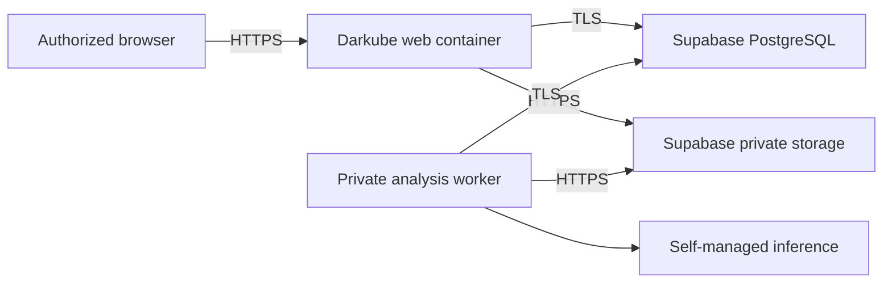

# Baztab Phase 1 Technical Specification

**Status:** Engineering baseline for review  
**Date:** 20 November 2026  
**Audience:** Product, engineering, infrastructure and pilot owners  
**Targets:** Hamravesh Darkube for Docker workloads, Supabase Free for PostgreSQL and private object storage  
**Product references:** [Product specification](product-spec.md) · [Design scope](design-scope.md)

## 1. Scope and decision status

Baztab is a Persian, internet-accessible web application for analyzing support calls. A signed-in organization member uploads Persian MP3 exports, tracks each call, views transcript evidence and scores, and explores recurring issues. Eligible results appear automatically. Members can optionally verify or correct findings. Every member uses the same organization workspace.

| Status | Decision |
| --- | --- |
| Agreed | Docker deployment on Darkube. Supabase Free hosts PostgreSQL and private recording objects for the pilot. |
| Agreed | Approximately 50 calls per day averaging three minutes, or 150 minutes of audio daily. Uploads accepted before midnight Tehran time are ready by 09:00 Asia/Tehran the following morning, every calendar day including Fridays and public holidays. The UI tells the member this ready time. |
| Agreed | Manual MP3 upload. Read a valid Gregorian YYYYMMDD filename prefix and display dates in Jalali. Label upload-date fallback as **تاریخ بارگذاری**. Exact duplicates within one organization are skipped. |
| Agreed | Transcribe and analyze with self-managed inference. Customer audio and transcripts are never sent to an external AI API. |
| Agreed | Configurable audio and transcript retention, measured in days. The pilot on Supabase Free keeps audio and transcripts for 10 days at full volume. The three-month (90-day) target applies only after a funded storage upgrade. Keep structured analysis, report counts and the original filename after expiry. |
| Agreed | Only allowlisted members can sign in. Each member is identified by organization national ID and mobile number. The operator issues a one-time initial password out of band when allowlisting, and the member must replace it at first sign-in. Password resets follow the same operator flow. Internal provisioning. Phase 1 excludes SMS, a customer-management UI, customer roles, automatic phone-system ingestion, and live call processing. |
| Agreed | A finding is reportable (eligible) when it has at least one validated evidence segment and a mapped issue category. Every outcome counts, including Unknown. Issue outcomes are Resolved, Unresolved and Unknown. An escalated or handed-off issue is Unresolved. Score criteria are problem understanding, correct information or action, and clear closure. |
| Proposed | One durable PostgreSQL queue, one private analysis worker, same-origin audio streaming, controlled issue taxonomy, and the pilot limits defined below. |
| Open | Inference host and resource size, primary and backup data locations, production retention for structured results, pilot quality thresholds, and scale beyond Free. |

The decisions above take precedence over the product specification and design scope. Both have been updated to match on format, limits, turnaround, retention, processing location and three further points:

- **Sign-in.** Password sign-in with an operator-issued initial password replaces the earlier passwordless SMS code flow.
- **Score criteria.** The second criterion is correct information or action (اطلاعات یا اقدام درست), replacing Gives clear guidance (راهنمایی روشن). The rating labels Met (2), Partly met (1) and Not met (0) stay.
- **Outcomes.** The fixed set is Resolved (حل‌شده), Unresolved (حل‌نشده) and Unknown (نامشخص). The earlier label Escalated (ارجاع‌شده) is dropped, and an escalated issue is Unresolved.

Phase 1 has no roles, so the uploader and reviewer user types in the product specification are the same organization members. The HTML prototype has not been updated and still shows the earlier flows. Phone-system exports almost always start with a YYYYMMDD date (for example 202607…), so Phase 1 has no shared batch date control. The rare unmatched filename uses the upload date.

## 2. Architecture

| Component | Responsibility |
| --- | --- |
| Web | Next.js App Router. Server-rendered Persian UI, sessions, upload, authorized range playback, status, reporting, and corrections. |
| PostgreSQL | Authoritative account and session state, tenant-scoped domain records, queue, results, correction history, retention state and release metadata. |
| Storage | Private MP3 objects in a dedicated bucket. PostgreSQL stores object metadata and transcripts. |
| Worker | Claims durable jobs, fetches audio, runs local transcription and analysis, publishes validated results, and performs bounded retention and reconciliation work. No public ingress. |
| Inference | Persian speech recognition and structured analysis run in the worker container or on a private operator-controlled host. CPU/GPU and model choice depend on benchmarks. |
| Release task | Applies reviewed Prisma migrations once per release and runs provisioning or maintenance commands with distinct credentials. |

**Data boundary.** Managed Supabase receives customer MP3s, transcripts and results. Darkube hosts the web workload and is the preferred worker host if it meets the resource and connectivity checks. These are external infrastructure providers even though neither is used as an AI inference API. Confirm that their locations, access and retention terms are acceptable for the pilot before uploading real records. Verify connectivity and permitted use in the actual Darkube cluster. A blocked provider path requires a deployment decision. Synthetic audio is sufficient for all infrastructure checks.

Use a modular monolith for the web app and one separate worker. Start with one web replica and one worker with concurrency one. PostgreSQL avoids a dedicated broker for the initial load. Keep queue access and object storage behind interfaces so operational limits can be addressed without changing the domain model.

## 3. Boilerplate adoption

Pin upstream commit [a6228062889af58805fba519cd2c00331808893d](https://github.com/amirmhp98/mhp-nextjs-boilerplate/tree/a6228062889af58805fba519cd2c00331808893d). Run its Persian setup in a fresh checkout since setup rewrites files and resets repository history. Keep upstream attribution. Verify the redistribution terms of the bundled font before shipping it.

| Use | Baztab adaptation |
| --- | --- |
| Next.js 16, React 19, TypeScript, Tailwind 4, local RTL shadcn components | Keep server pages and services for reads, Server Actions for small mutations, and authenticated HTTP handlers for media. Adopt lint-enforced boundaries and Zod validation. |
| Persian locale, date range picker, formatters, bilingual digit normalization and phone normalization | Reuse locale tools and add organization national-ID validation for the 11-digit legal-entity identifier (شناسه ملی) with its check digit. The bundled validator checks a 10-digit personal code and must not be reused for organizations. Treat both identifiers as strings and preserve leading zeros. |
| Prisma 6, committed migrations, PostgreSQL fixtures | Replace the sample username/role schema with organizations and memberships. Reuse session-token storage and server-side session checks. |
| Sample admin routes, dashboard, development seed and auth bypass | Exclude sample admin/gallery routes and default credentials from the production build. Verify production refuses auth bypass. Publish Baztab requirements in the repository PRD and record architecture changes in decision records. |
| Docker, Vitest, Playwright, CI | Keep the standalone build and quality checks. Split web, worker and migration execution. Local Compose is for development. Deploy versioned images to Darkube. |

Previous repository verification at this commit covered the production compile, 142 unit tests and lint/type/format checks after Persian setup. Baztab's browser tests, live Supabase behavior, Docker images and Darkube deployment require their own verification.

## 4. Authentication and organization access

1. An internal operator command provisions or revokes an organization/member pair. Only allowlisted, active memberships can sign in. The command records the operator, action, time and target, with no secrets in the audit record. Repeat provisioning is idempotent.
2. Provisioning generates a random one-time initial password, stores only its Argon2id hash, marks the membership as requiring a password change, and shows the plaintext once to the operator. The operator delivers it to the member out of band (in person or through an existing customer contact). The initial password expires after a configurable period, proposed at 7 days. Knowing the national ID and mobile alone never grants access.
3. At first sign-in with the initial password, the member can only set a new password. Set the new password, clear the change requirement and invalidate the initial credential in one transaction. A reset uses the same command: the operator issues a new one-time password, which invalidates the old password and all of the member's sessions.
4. Sign in using organization national ID, mobile and password. Use generic failure responses. Proposed rate limits are 5 failures per account per 15 minutes with increasing delay rather than a hard lockout, and 30 failures per network source per 15 minutes. Keep rate-limit state in PostgreSQL so it survives restarts and multiple replicas, and expire it. Passwords must be 10 to 128 characters and may contain only printable ASCII: Latin letters, Latin digits and standard symbols. Reject Persian or Arabic letters, Persian digits and any other non-ASCII character with a specific localized message. Passwords must not equal the national ID or mobile, and must not appear on a bundled common-password list. Use Argon2id and benchmark its cost under peak login load.
5. Issue an opaque random session cookie with HttpOnly, Secure and SameSite=Lax. Store a token hash with expiry. Proposed lifetime is 24 hours idle and 7 days absolute. Check organization and membership activity per request. Revocation blocks subsequent API and playback requests, including requests using an existing session. Authenticate all mutations and verify origin for cookie-authenticated unsafe HTTP methods.
6. Derive organization scope from the session, never from an organization ID supplied by the customer. Use composite tenant keys in queries and foreign keys. Return a generic 404 for missing or foreign records after authentication. Supabase Auth and browser-side database access are outside this baseline.

Keep private database schemas outside the Supabase Data API exposure. Use dedicated least-privileged web and worker database roles without ownership or BYPASSRLS and a separate migration role. Service-level tenant predicates and tenant-consistent foreign keys are mandatory. If RLS is added for defense in depth, test it with the actual runtime roles and pooler. Any per-tenant context must be transaction-scoped. Access Storage with Supabase S3 access keys only. Never deploy the service-role or anon API keys, because the service-role key also grants full Data API access to the database. Treat the S3 keys as privileged: they reach every object in the project. Bucket paths help organize objects. The application must authorize each access.

Record an access log entry for each audio playback session and transcript view, with membership, call, action and time. Retain it with the structured call record.

**Offboarding.** Revoking an organization immediately blocks all its sessions and access. A separate operator deletion command removes all of the organization's records, structured results and objects. Backups expire under the backup retention policy in §10.

## 5. Data model and invariants

Use opaque IDs, UTC timestamps for instants and PostgreSQL DATE for a Gregorian call date. Put an organization ID on tenant-owned records and enforce tenant consistency in database relationships. Store normalized mobile numbers only where required for identity. Object keys are generated, such as org-id/call-id/original.mp3. Keep the original filename as restricted metadata. It can contain a caller's phone number, so it is searchable and shown only to members of the owning organization, kept after audio expiry by decision, and never written to logs, object keys or telemetry.

| Entity | Core fields and rules |
| --- | --- |
| Organization | ID, unique normalized organization national ID, name, active state, retention configuration. Phase 1 report zone Asia/Tehran. |
| Membership | Organization, normalized mobile, credential hash, password-change-required flag, initial-password expiry, activation/revocation timestamps. Unique organization/mobile pair. |
| Session | Membership, token hash, idle and absolute expiry. Resolves active membership and organization. |
| Call | Organization, call ID, original accepted timestamp, nullable filename date, effective date, date source, original filename, visible state, active analysis revision and row version. The call ID is the internal opaque ID. The UI shows a short reference derived from it for search and support. |
| Recording | Call, private object key, bytes, measured duration, content type, expiry and storage state. |
| RecordingFingerprint | Organization, exact file SHA-256, owning call. Unique organization/hash. Deleted when the recording expires. A re-upload of an expired file creates a new call that counts separately. |
| ProcessingJob | Call, operation, attempt, state, next run time, lease token/expiry, stable error code, enqueue and completion timestamps. Only one active job per call and operation. |
| TranscriptSegment | Call revision, ordered segment index, start/end milliseconds, speaker enum (agent, customer, unknown) and Persian text. |
| AnalysisRevision | Call, version, reason (initial, retry, reprocess, correction), parent revision, output schema version, model identifiers, prompt/rubric/taxonomy versions, processing status and timestamps. Publish atomically. |
| IssueFinding, IssueCategory | Call revision, normalized category ID, outcome (Resolved, Unresolved, Unknown), derived eligibility, optional explanation and evidence references. Eligible means at least one validated evidence segment and a mapped category. Use stable tenant-scoped category IDs and track taxonomy provenance. |
| Score, Evidence | One rating per rubric criterion per revision: problem understanding, correct information or action, clear closure. Each is 0, 1, 2 or insufficient evidence, with an optional explanation and validated segment references. Evidence never depends on a copied transcript quote. |
| CorrectionAudit | Source revision, resulting revision, actor, field, previous value, new value and timestamp. Store structured values only, never transcript or explanation text. |

A correction never edits a published revision. It creates a child revision with reason correction, copies unchanged values, applies the edits and becomes active in one transaction. Corrected fields are flagged as human-set. After audio and transcript expiry, members can still correct category, outcome and ratings without evidence. Explanations and evidence references are deleted at expiry, so after expiry only structured values, the original filename and permitted metadata remain.

Index organization/effective date/call ID for pagination and reports, organization/category/revision for drill-down, job state/next run time for claims, and expiry fields for cleanup. Test query plans at the expected 90-day volume and projected structured-history volume.

## 6. Upload, dates and media

The browser can select a batch. It submits each MP3 independently, with bounded concurrency and separate accepted, duplicate and rejected results. A suggested first pilot limit is 50 selections, two concurrent requests per browser and 10 MiB per file, subject to the phone export measurements and Darkube ingress tests. Enforce size and time limits at ingress and in the application. Require MP3 extension and validate the actual media format and duration. Preserve original bytes. Reject empty, corrupt and unsupported files with localized errors.

Use a streaming multipart route. Limit scratch space, hash original bytes and validate using a controlled decoder invocation (ffprobe, packaged in the web image) with time and resource limits. Clean temporary data on all outcomes and after restart. Use the unique fingerprint to reserve the call and account for bytes before storing the object. Initial upload reservations are internal. A conflicting upload reports an upload in progress or returns the existing call once committed. On storage success, transactionally mark the call queued and insert its first job. If finalization fails, reconcile only after checking the exact stored object and reservation state. Delete expired unmatched uploads, release their reserved bytes, and make a retry safe. No background job claims an uncommitted upload.

Parse the leading eight digits only when the filename ends there or the next character is not a digit, using strict Gregorian date validation. For example, the filename prefix 20261019 becomes 2026-10-19 and displays as **۱۴۰۵/۰۷/۲۷**. A prefix such as 2026101912 does not match. Reject a parsed date that is later than the accepted date in Asia/Tehran or earlier than a configurable minimum (default 2020-01-01), and fall back to the upload date. Treat the rest of the filename as opaque. The filename never affects whether an upload is accepted: a file with any name, including one without a date prefix or one with Persian characters, spaces or symbols, is accepted and processed normally, with no error or warning. Only the date source changes. Do not search for a date elsewhere in the name, because other digit runs such as phone numbers could be misread as dates. Use the accepted-at date in Asia/Tehran when no source date can be parsed. Keep date source in the API and show the fallback label. Range filtering uses calendar dates and shared inclusive bounds for summaries and drill-down. Scheduling uses accepted-at timestamps. Retry preserves both values.

Serve audio through an authenticated same-origin endpoint. Validate current access and expiry for each request. Stream approved byte ranges from private storage and preserve appropriate 200/206/416 responses. Set private, no-store caching and avoid persisting response bodies in logs. Do not expose a storage credential or long-lived URL to the browser. Test browser seeking behind the actual ingress before enabling playback.

## 7. Worker lifecycle and overnight target

| State | Rule |
| --- | --- |
| Queued | Upload is committed or a retry has been accepted. |
| Processing | A worker holds an unexpired lease. The UI can display transcription or analysis progress. |
| Ready | A complete validated analysis revision is published and appears in reports automatically. |
| Failed | Attempts are exhausted or a permanent fault occurred. Successful siblings remain available. The member can retry a recoverable failure individually while the source is retained. Audio with no usable Persian speech (silence, music, another language) fails permanently with code no_usable_speech and is excluded from the analyzed-call total. |

Claim jobs atomically using a short PostgreSQL transaction with row locking and SKIP LOCKED. Process outside the transaction. Assign a unique lease token, renew it while a job is running and reclaim expired leases. Fence final writes by job ID and current lease token so a stale worker cannot publish. On termination, stop claiming work and finish within the grace period or allow reclamation. Apply bounded exponential backoff to transient failures. Persist stage checkpoints so a retry can reuse an unexpired transcript produced by the same model revision. Duplicate retries converge on one active job. A retry after an initial failure retains the same call ID, recording, fingerprint and accepted timestamp.

Stage the output and publish its revision and job completion in a single transaction. Report reads see either the prior published revision or the complete new one. For Phase 1, expose retry for failed processing. Reprocessing an already published result is an operator operation. It produces a new revision. If the active revision has no human-set fields, the new revision becomes active. Otherwise it is stored as a candidate and does not become active until the operator runs an audited command that either activates it (discarding the corrections) or keeps the corrected revision.

Start processing as soon as uploads are accepted. The deadline applies every calendar day, including Fridays and public holidays. Assign an operational reporting day by Tehran local time. An upload accepted at 23:59 belongs to that day and is due the next morning under the agreed target. A file whose upload finishes at or after midnight belongs to the new day. The deadline is 09:00 Asia/Tehran. A midnight burst of 150 audio minutes has a nine-hour maximum window. Benchmark the complete batch in six hours or less as a proposed engineering target to leave three hours for recovery. Measure successful completion and report failures separately so a fast failure cannot satisfy the processing target. Record actual batch duration, queue age and oldest due job. The upload response and call detail return the expected ready time: 09:00 Tehran on the day after the call's operational reporting day.

The overnight target is accepted only after a feasibility gate in the infrastructure proof. Measure per-call wall time for transcription plus analysis on the candidate host. One worker with concurrency one needs to average about 7 minutes or less per three-minute call to finish 50 calls in six hours. If it cannot, choose before the vertical slice between a GPU or larger private host, smaller models, higher worker concurrency, or a reduced daily volume or later deadline.

## 8. Self-managed AI and evaluation

- Decode MP3 locally for processing. Run Persian automatic speech recognition with stable millisecond timestamps. Label segments agent or customer only when attribution is confident (from channel separation, diarization or the analysis model), and keep them unknown otherwise. A criterion that depends on the agent's behavior must cite agent-attributed evidence or be rated insufficient evidence. Report the share of unknown segments in the evaluation.
- Treat transcripts as untrusted data. The analysis model gets transcript segments and a fixed task schema, without tools, provider calls or network privileges. Use a pinned model artifact and record its checksum, license, runtime and version. Pin prompts and the output schema. Keep raw data out of external telemetry or support logs.
- Require a structured response with reason, distinct issues, per-issue outcome, evidence segment IDs and all three score criteria. Validate schema, enum values, segment ownership and time bounds before publishing. Outcomes are Resolved (fixed during the call), Unresolved (left open, escalated or handed off) and Unknown (cannot be determined from the transcript). Use Insufficient evidence for unassessable scores. Never invent transcript evidence. Invalid structured output can be retried within an attempt budget.
- Begin with a versioned, support-approved set of issue categories. Map to stable category IDs and retain sufficiently evidenced uncategorized findings for inspection. Uncategorized findings are not eligible and are excluded from ranked categories until mapped, while the call stays in the analyzed-call total. Allow correction of the category through the existing optional review flow.
- Keep outcomes distinct from call-handling scores. An escalated call has an Unresolved outcome but may still score fully on clear closure. The three criteria are problem understanding, correct information or action, and clear closure (the agent confirms the result or explains what happens next). Each is rated Met (2), Partly met (1) or Not met (0), totalling six only when all three are assessable. Show incomplete otherwise. Define the anchor for each rating in the versioned rubric before labeling the samples.
- Label the 10 supplied Persian sample calls on approved infrastructure. Capture transcription word error rate with agreed Persian normalization, per-issue detection and outcome agreement, evidence validity, per-criterion score agreement, processing wall time, and peak RAM/VRAM. Include multi-issue calls, poor audio and ambiguous outcomes if present. Report coverage gaps. Use this sample for screening models. Use a separate representative set before claiming pilot accuracy. Compare CPU first and validate a GPU option only if quality or runtime requires it.

## 9. Interfaces and report consistency

The table describes logical contracts. Ordinary form mutations can use authenticated Server Actions with equivalent input, error and concurrency behavior.

| Operation | Contract |
| --- | --- |
| Sign in / change initial password / sign out | Accept normalized national ID, mobile and password. A membership that requires a password change gets only the change-password step. Generic user-facing failures, no secret echo, session revocation on sign-out. |
| POST /api/calls/uploads | One multipart MP3. Return call ID, effective date, state and expected ready time for success, existing call for a duplicate, a bounded retry response for an in-progress reservation, or a localized error code. |
| GET /api/calls | Cursor-based search by call ID, filename or issue. Filters for state, issue and inclusive call date bounds. Stable ordering by effective date and call ID. |
| GET /api/calls/:id | Effective date and source, visible state, expected ready time while queued or processing, availability of audio and transcript and their removal date, active analysis and review versions. Paginate transcript separately if required. |
| GET /api/calls/:id/audio | Session-authorized range playback. Return a localized expired/unavailable state on the detail page. |
| Retry call | Accept call ID. Retry only an eligible failure. Concurrent submissions return the same active job. |
| Correct or confirm review | Require active result version. Reject stale edits with a conflict and prompt reload. Save current findings and audit changes in a single transaction. |
| GET /api/reports/issues | Return analyzed-call total and issue ranks for date bounds. Rank on distinct eligible calls per category with deterministic tie-breaking. Return a drill-down filter for each rank. |

Provide stable error codes for invalid media, size, inactive access, storage budget, transient dependency failure, missing evidence and stale updates. Use Persian UI strings through the boilerplate dictionary. Protect authenticated responses from shared caching. Refresh scoped views after mutation.

The total includes ready calls with zero reportable categories. A finding is eligible when it has at least one validated evidence segment and a mapped category, whatever its outcome. Eligibility is fixed when the revision is published and is not recomputed when evidence is later deleted at expiry. Count each call once per eligible category. A call can count under several categories. Distinct exports of a follow-up call count separately. The report and drill-down use the same eligibility predicate, tenant scope and date bounds. Concurrent corrections may change a live drill-down after a report was viewed, so show the report generation time and refresh both views on return. A correction updates the live count after commit. Playback or transcript expiry does not change historical counts. Optional review never gates report inclusion.

## 10. Retention, capacity and availability

Retention is configured in whole days from the accepted upload time, which avoids differences between Jalali and Gregorian month lengths. The pilot value is 10 days. The production target is 90 days, used once a funded storage plan is in place. At expiry, hide audio, transcript and evidence immediately at authorization time. Mark them unavailable and let an idempotent deletion task remove the storage object, transcript segments, excerpts and transient processing artifacts. A missing object counts as already deleted. Retry failed deletes and confirm completion before releasing storage budget. Do not let an in-flight worker republish evidence after expiry. Delete the recording fingerprint, model-written finding and score explanations, and evidence references. Preserve structured categories, outcomes, ratings, the original filename and the access log. Audit records hold structured values only. Keep only permitted metadata and redact or expire logs. Apply the same deletion policy to approved backup copies, or enforce equivalent expiry before restored data becomes accessible.

### Supabase Free capacity

Published limits include 500 MB database per project, 1 GB file storage, 5 GB uncached and 5 GB cached egress, a 50 MB platform file limit, and possible pause after a week of inactivity. Free excludes automatic backups and point-in-time recovery. MP3 sizes below use decimal units and exclude overhead.

| Average encoded bitrate | One three-minute call | 50 calls/day | 90 days of original recordings | Approximate days within a proposed 800 MB app budget |
| --- | ---: | ---: | ---: | ---: |
| 32 kbps | 0.72 MB | 36 MB | 3.24 GB | 22 |
| 64 kbps | 1.44 MB | 72 MB | 6.48 GB | 11 |
| 128 kbps | 2.88 MB | 144 MB | 12.96 GB | 5.5 |

Even at 32 kbps, 90 days exceed Free storage. At 64 kbps, 10 days of recordings use about 720 MB, which fits the 800 MB budget. At 128 kbps, 10 days need about 1.44 GB and do not fit, so measure the real export bitrate first. At 64 kbps a 30-day month uses about 2.16 GB of uncached egress for one inference fetch per call. One full playback per call adds another 2.16 GB, before retries, backups and database traffic. Use actual file sizes and provider usage metrics to forecast both storage and egress.

**Pilot policy.** Use Supabase Free at full daily volume with 10-day audio and transcript retention. This is an agreed reduction from the three-month target. Set an app-managed storage budget of 800 MB, counting committed and in-flight objects, and reconcile against provider usage. Alert at 70% of that budget and stop admitting new uploads at the budget with a clear localized message. If the measured bitrate makes 10 days exceed the budget, lower the configured retention days as an explicit, recorded decision. Never silently shorten retention, remove prior calls or transcode originals to fit the quota. The worker fetches each recording once per job and reuses its scratch copy across retries within an attempt. Alert at 70% of monthly egress as well. Measure database growth across transcript rows, indexes, job history and audit records. Track storage and egress for the whole applicable Supabase account. Full-volume launch requires a funded storage capacity decision, such as upgrading Supabase or explicitly approving another object store.

**Recovery.** Approve backup policy, recovery point and recovery time before using customer data. Proposed targets for review are a 24-hour recovery point and restoration within one business day, subject to restore testing. Use encrypted logical application-schema backups and separately protect Storage objects when policy requires source recovery. A database dump does not contain MP3 objects. Keep backup copies for at most 7 days, so expired audio and transcripts leave every copy within 7 days of expiry. Test restore into an isolated environment. Reconcile object manifests, clear expired snapshots and prevent restored sessions or revoked memberships from restoring prior access. Free projects can pause, so rehearse unpause and monitor real dependency failures. Track backup egress and do not claim the overnight target during provider outages before validating recovery capability.

## 11. Docker, Darkube and Supabase deployment

| Workload | Deployment contract |
| --- | --- |
| baztab-web | Multi-stage Node image with standalone Next.js output, pinned base and lockfile, non-root process and port 3000 on 0.0.0.0. Darkube public application with custom DNS and HTTPS. No persistent volume required. |
| baztab-worker | Separate Linux image with pinned runtime and decoder. Start one private workload with an explicit entrypoint and bounded ephemeral storage. Package approved models or fetch them from a controlled artifact source before accepting work. Validate CPU, memory, image size, startup and persistent cache needs in the selected Darkube plan. If it cannot run the benchmark, place the worker on a private operator-controlled Docker host with approved Supabase access. |
| baztab-migrate | Versioned one-shot release artifact or controlled CI runner, with metadata and migration credentials. Run Prisma migrate deploy once before compatible application rollout. Remove automatic migrations from web startup. |
| Local and CI | Compose can run local PostgreSQL with an isolated object-storage test implementation. Integration smoke tests also use an isolated Supabase project. Tests and seeds use synthetic fixtures. |

Darkube documents deploying Docker images, custom domain/port settings and separate workers. Available CPU/GPU, network policies, exact ingress limits, secret handling, probe settings and release features must be verified for the chosen plan and cluster. Use a reachable private registry with immutable image tags and record digests. Deploy staging first, then promote the same tested images. Verify TLS certificate renewal, forwarded headers and authentication origin handling. Expose only web ingress. Keep browser traffic same-origin.

Use Supavisor **session mode** on 5432 initially for long-lived web/worker connections and the migration job, with separate credentials and small pools. Start with no more than three connections for the web and two for the worker, then verify under load and rolling restart. Use TLS with certificate and hostname verification supported by each driver. If the application later needs transaction pooling, configure Prisma's documented compatibility settings and continue using session mode or a suitable direct endpoint for migrations. Ensure Darkube can reach the actual Supavisor hostname and Storage endpoint over TLS. Restrict database schemas and grants to the application contract. Keep sample database and seed credentials out of deployed manifests.

| Configuration | Owner and use |
| --- | --- |
| DATABASE_URL_WEB, DATABASE_URL_WORKER | TLS pooler URLs with distinct runtime roles. Map the appropriate URL into the service's Prisma/driver configuration. |
| DATABASE_URL_MIGRATE | Release-only migration connection. Never injected into web or worker. |
| STORAGE_ENDPOINT, STORAGE_BUCKET, STORAGE_ACCESS_KEY_ID, STORAGE_SECRET_ACCESS_KEY | Server-only Supabase S3 access keys for the private bucket. No service-role or anon key. Isolate environments at project level. |
| APP_ORIGIN, PORT, REPORT_TIME_ZONE | Canonical HTTPS origin, Darkube port, and Asia/Tehran scheduling/display default. |
| SESSION settings, initial-password expiry, upload limits, retention and storage budget | Validated runtime settings. Keep credentials outside all browser-visible environment variables and image layers. |
| Model and worker settings | Model version/checksum, CPU/GPU device, concurrency, lease/heartbeat, timeouts and retry budget. |

**Release order.** Build and scan images, run unit and integration tests, deploy synthetic staging, apply backward-compatible migrations, deploy web and worker, then verify login, upload, worker completion, report and playback. Roll back application and worker images together to a compatible revision. Use corrective migrations when a schema change cannot be safely reversed. Block destructive migrations until compatible code is deployed and recovery has been tested.

**Operations.** Use a process-only liveness check and a lightweight DB/schema readiness check. Worker heartbeats and synthetic end-to-end jobs cover inference and storage. Track queue depth, oldest job age, lease expiries, per-stage latency, failures, storage/egress and failed deletions. Alert on deadline risk, elevated failures, missed heartbeats and capacity thresholds. Log request/job IDs, sanitized error codes and model versions without call content, full filenames, credentials, or customer identifiers. Document how operations pauses new uploads, drains the worker, restores services and retries affected calls.

## 12. Acceptance and release criteria

| Coverage | Required verification |
| --- | --- |
| P1-01 uploads and retries | Upload a multi-file batch with corrupt, valid and duplicate MP3s, including valid files whose names have no date prefix or contain Persian characters, and confirm those are accepted. Verify the expected ready time shown for uploads before and after midnight. Race two identical files and confirm one call. Simulate storage failure between reservation and finalization. Verify retries, orphan cleanup and no double count. |
| P1-02 and P1-03 AI | Test Persian transcription, unknown speaker, multi-issue outcomes and timestamp consistency on the sample set. Reject invalid model output. Disconnect external inference network routes and verify processing still works. |
| P1-04 reporting | Verify distinct-call counts, empty analyzed calls, multi-issue drill-down, exclusion of no-evidence and uncategorized findings, Unknown outcomes still counted, Jalali filters, malformed, future and over-long filename dates, month boundaries and midnight Tehran behavior. |
| P1-05 scoring | Exercise each rating, insufficient evidence and escalated-but-clear call closure. Verify incomplete and six-point totals. |
| P1-06 review | Review remains optional. Concurrent edits detect a stale revision. An accepted correction creates a child revision, changes the report and records actor and delta. Operator reprocessing never activates over human-set fields without the audited command. Corrections after expiry work without evidence. |
| P1-07 access | Use two organizations, including the same mobile in both, to verify isolation across pages, APIs, files, jobs and corrections. Verify that non-allowlisted identifiers cannot sign in, the initial password forces a change and cannot be reused, expired initial passwords fail, an operator reset invalidates old passwords and sessions, passwords with Persian or other non-ASCII characters are rejected with the specific message, and session expiry, origin checks, rate limits, access logging and credential redaction all work. |
| Lifecycle and quotas | Expire audio while a job is active, verify links disappear and no evidence is republished. Verify that explanations and the fingerprint are deleted, the filename is kept, and re-uploading an expired file creates a new call. Test delete retry, partial storage recovery, cap enforcement, no_usable_speech handling and historical totals after expiry. |
| Infrastructure and resilience | Test HTTPS, actual ingress file limits, Range seeking, database TLS, worker crash/reclaim, rolling restart and image rollback in Darkube against an isolated Supabase project. Simulate provider downtime and validate recovery from an approved backup. |
| Overnight capacity | Benchmark 10 representative local samples, then 50 call-equivalents including a midnight burst, retries and at least one worker restart. Record completion time, quality, hardware usage and expected egress. |

### Implementation order and decisions before customer data

1. **Infrastructure proof:** Deploy disposable Docker web and private worker workloads. Test Darkube-to-Supabase database and object access, media streaming and an isolated inference run with synthetic recordings. Pass the per-call feasibility gate in §7 and measure the real export bitrate.
2. **Vertical slice:** Provision two test organizations, sign in with operator-issued initial passwords, upload and process one MP3, verify playback and report, and demonstrate isolation. Add robust batch, retry and corrections.
3. **Pilot:** Agree on hosting/data permissions, benchmark thresholds, encrypted backup and deletion policy, and confirm that 10-day retention fits the measured bitrate. The customer confirms its legal basis for recording calls and for sharing them with Baztab, and that callers are notified as required. Use the ten recordings only in the approved environment.
4. **Launch:** Choose a storage capacity plan that meets 90-day retention at measured full volume, then raise the configured retention from 10 to 90 days. Verify quota headroom, overnight processing, customer isolation, recovery and rollback before opening uploads at that volume.

## Sources

- Hamravesh: [Darkube overview](https://docs.hamravesh.com/products/darkube) · [Docker image deployment](https://docs.hamravesh.com/products/darkube/create/docker-image/intro/) · [Quick start including background workers](https://docs.hamravesh.com/products/darkube/getting-started)
- Supabase: [Pricing and plan limits](https://supabase.com/pricing) · [Prisma and Supavisor](https://supabase.com/docs/guides/database/prisma) · [Storage buckets](https://supabase.com/docs/guides/storage/buckets/fundamentals) · [S3 compatibility](https://supabase.com/docs/guides/storage/s3/compatibility) · [Storage bandwidth](https://supabase.com/docs/guides/storage/serving/bandwidth) · [Backups](https://supabase.com/docs/guides/platform/backups) · [Regions](https://supabase.com/docs/guides/platform/regions)
- [Next.js self-hosting guidance](https://nextjs.org/docs/app/guides/self-hosting) · [Server Action body limits](https://nextjs.org/docs/app/api-reference/config/next-config-js/serverActions)
- [OWASP password recovery guidance](https://cheatsheetseries.owasp.org/cheatsheets/Forgot_Password_Cheat_Sheet.html)
- [NIST AI RMF Measure guidance](https://airc.nist.gov/airmf-resources/airmf/5-sec-core/)
